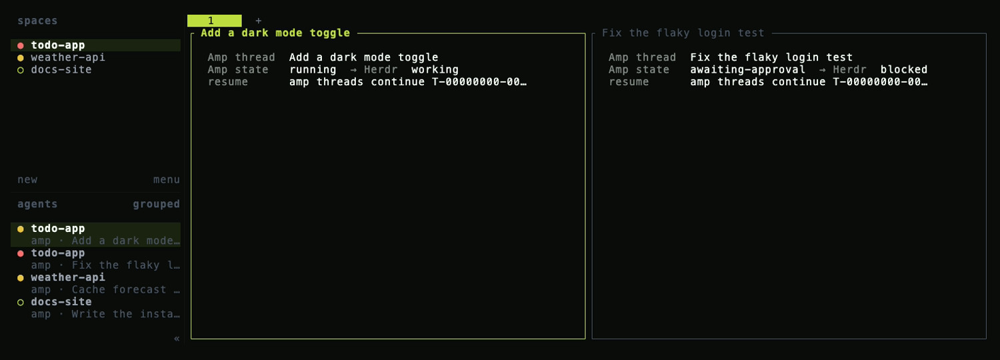

# amp-herdr

[](https://github.com/cwkendall/amp-herdr/actions/workflows/test.yml)
[](LICENSE)

[Amp](https://ampcode.com) integration for [Herdr](https://herdr.dev). Herdr
detects Amp from its screen. amp-herdr has Amp report to Herdr directly, the
same way Herdr's built-in integrations do for Pi or OpenCode.



*Four demo threads in the [Amp theme](#amp-theme). Each pane prints the report
its Amp plugin sent. The sidebar lists each thread as `amp · <title>` with its
state: working (yellow), blocked on approval (red), done (teal) until you view
it, or idle (green). Split panes also show the title on their border.*

| | Without amp-herdr | With amp-herdr |
| --- | --- | --- |
| Agent state | Read from the screen | Reported by Amp: `working`, `blocked` on approvals and errors, `idle` |
| Server restart | Amp panes come back as empty shells | Herdr reopens the same thread with `amp threads continue <id>` |
| Sidebar and pane title | `amp`, and no pane title | `amp · <thread title>`, and the thread title on split pane borders |
| Open a thread | Type `amp threads continue` yourself | Pick a recent thread from a popup |
| Threads started elsewhere | Not in Herdr | `sync` opens recent threads in their project workspace |

It works with any Amp deployment, including self-hosted tenancies: it runs the
`amp` on your `PATH` and never talks to the Amp API itself.

## Requirements

- Herdr 0.9.2 or later
- Amp CLI with plugin support
- Node.js 22.18 or later
- macOS, Linux, or Windows

## Install

```bash
herdr plugin install cwkendall/amp-herdr
```

Herdr installs the Amp plugin and registers the Herdr plugin. Restart running
Amp sessions, or run `plugins: reload` in each, to start reporting. Check the
result with `herdr plugin list`.

Update with `herdr plugin update amp-herdr` on Herdr 0.9.4 or later. Earlier
versions have no `plugin update`; run the install command again instead.

### Command-line tool

Herdr does not put plugin commands on your `PATH`. For the `amp-herdr` command,
which `upgrade` and `status` need, install it with npm:

```bash
npm install -g github:cwkendall/amp-herdr
```

Run the same command to update it.

### Uninstall

Remove the Amp plugin first, because the Herdr plugin restores it whenever
Herdr starts:

```bash
amp-herdr uninstall
herdr plugin uninstall amp-herdr
```

Without the `amp-herdr` command, delete `~/.config/amp/plugins/amp-herdr.ts`
(`%USERPROFILE%\.config\amp\plugins\amp-herdr.ts` on Windows) instead.

## Use

Run Amp in a Herdr pane as usual. The sidebar shows the thread title and
state, and Herdr notifies you when Amp needs approval or finishes. After a
Herdr server restart, reattach and each Amp pane resumes its thread.

The Herdr plugin adds two actions. Bind them to keys in Herdr's `config.toml`:

```toml
[[keys.command]]
key = "prefix+a"
type = "plugin_action"
command = "amp-herdr.open"
description = "open Amp thread"

[[keys.command]]
key = "prefix+shift+a"
type = "plugin_action"
command = "amp-herdr.sync"
description = "sync Amp threads"
```

The same commands work from a shell:

```text
amp-herdr open [thread-id]        Open a thread, or pick one from recent threads
amp-herdr sync [--since 24h]      Open recently updated threads that are not open yet
                [--dry-run]
amp-herdr upgrade [session]       Stop outdated Herdr sessions that restart safely
                  [--yes]
amp-herdr status                  Show what is installed and what Herdr sees
amp-herdr install                 Set up both plugins from this copy instead of Herdr
amp-herdr uninstall               Remove both plugins
```

`open` focuses a thread that is already open instead of opening it twice. New
threads open as a tab in the workspace for their project directory, or in a new
workspace. Each thread starts its own Amp client, so `sync` opens at most 10
threads at a time; run it again for the rest.

### Amp theme

To give Herdr the look of Amp's interface, add this to Herdr's `config.toml`.
It keeps your terminal's background and uses Amp's lime accent, text, and
error colors. It suits dark terminals.

```toml
[theme.custom]
panel_bg = "reset"
accent = "#bfdd42"
text = "#f6fff5"
subtext0 = "#9ca3af"
overlay0 = "#4b5563"
overlay1 = "#6b7280"
surface0 = "#1a1d1a"
surface1 = "#262a26"
surface_dim = "#121412"
active_row_bg = "#1d2412"
selection_bg = "#2b3518"
green = "#bfdd42"
teal = "#7fae5a"
yellow = "#e8c547"
red = "#f87171"
blue = "#7aa2f7"
```

### Upgrading Herdr with a package manager

Herdr's live handoff keeps panes running across updates, but only for its own
installer and only on macOS and Linux. Homebrew, mise, and Nix updates, and
every Windows update, leave old servers running until they stop. After such an
update, run:

```bash
amp-herdr upgrade
```

It checks every running session, or the one you name. A session stops only
when it is outdated and every pane survives the restart: an idle shell, or an
idle agent that Herdr can resume natively or that reports its Amp thread, with
nothing else running beside it. It lists anything else, such as a dev server,
a suspended editor, or an Amp session started before this plugin was
installed, and leaves that session running. It asks once before stopping
anything and never starts a terminal; reattach with `herdr --session <name>`.

Agents come back only while Herdr's `resume_agents_on_restore` setting is on,
which is the default. Tasks an agent runs itself, such as Claude Code
background shells, stop with it.

## How it works

`amp/amp-herdr.ts` is an Amp plugin. Inside a Herdr pane it follows the thread
you are viewing and reports it through Herdr's
[agent reporting API](https://herdr.dev/docs/add-herdr-support/):

- `pane.report_agent` with the thread state and
  `resume_argv = ["amp", "threads", "continue", "<thread-id>"]`
- `pane.report_metadata` with the thread title, the sidebar name
  `amp · <title>`, and an `amp_thread` token. The sidebar name takes the place
  of a name set with `herdr agent rename`, which still works for lookups.
- `pane.release_agent` when Amp exits

Outside Herdr it does nothing, and so does an `amp -x` that Amp starts in its
own pane. Reports are queued and coalesced so a slow
socket never slows Amp down.

`herdr-plugin.toml` declares the Herdr plugin. Its build and startup hooks keep
the Amp plugin current, and its actions run `bin/amp-herdr`, which uses the
`herdr` and `amp` CLIs.

## Development

```bash
npm test
herdr plugin link .   # use this checkout as the Herdr plugin
```

Test end to end in a separate named session such as
`herdr --session amp-herdr-test`, so a restart does not affect your work.

## Releasing

Release every user-visible change. Use [semantic versioning](https://semver.org):
patch for fixes, minor for features, and major for breaking changes.

```bash
npm version patch   # or minor, major
git push --follow-tags
```

`npm version` runs the tests, sets the version in `package.json` and
`herdr-plugin.toml`, commits, and tags `vX.Y.Z`. Pushing the tag publishes a
GitHub release with generated notes.

`herdr plugin update` installs the newest commit of the ref the plugin was
installed from (the default branch unless `--ref` was given) and ignores the
version. To pin a release, use `herdr plugin install cwkendall/amp-herdr --ref vX.Y.Z`.

## License

Copyright 2026 Chris Kendall. Licensed under the [Apache License 2.0](LICENSE).
